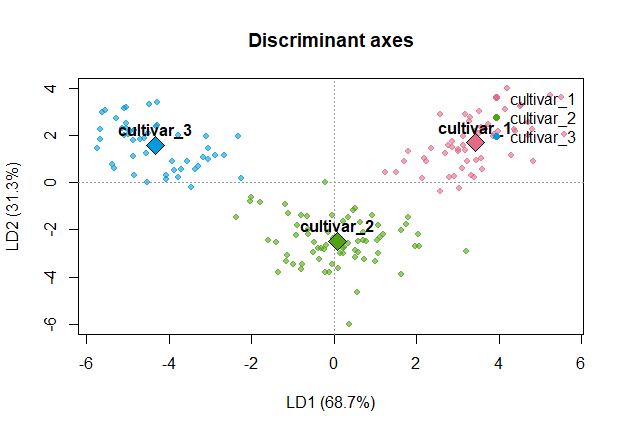
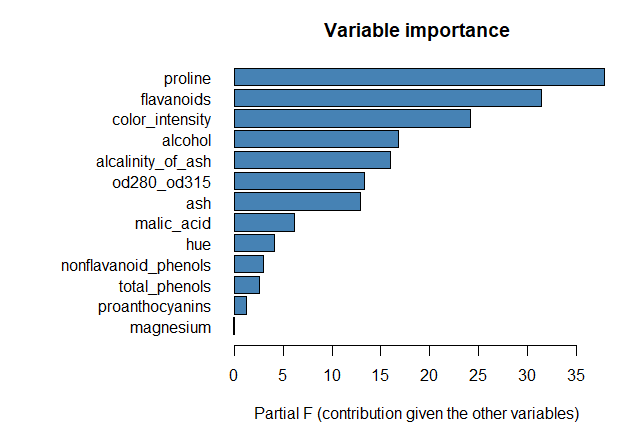
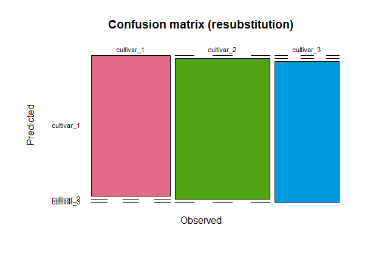

ldapkg tutorial: predictive linear discriminant analysis
================

- [1. Fitting a model with `$fit()`](#1-fitting-a-model-with-fit)
- [2. Reading the outputs](#2-reading-the-outputs)
  - [Classification functions](#classification-functions)
  - [Global quality: Wilks’ lambda](#global-quality-wilks-lambda)
  - [Contribution of each variable](#contribution-of-each-variable)
  - [Discriminant axes, confusion matrix,
    metrics](#discriminant-axes-confusion-matrix-metrics)
  - [Detailed report](#detailed-report)
- [3. Predicting with `$predict()` and
  `$predict_proba()`](#3-predicting-with-predict-and-predict_proba)
- [4. Cross-validation](#4-cross-validation)
- [5. Categorical predictors](#5-categorical-predictors)
- [6. Variable selection](#6-variable-selection)
- [7. Plots](#7-plots)
- [8. Robustness](#8-robustness)
- [9. The Shiny application](#9-the-shiny-application)

This tutorial shows how to use the `ldapkg` package: fitting a model,
reading its outputs, predicting new individuals, handling categorical
predictors, selecting variables, estimating the error by
cross-validation, plotting, and running the Shiny application. Every
chunk is reproducible with the data shipped with the package.

``` r
# install.packages("remotes")
remotes::install_github("https://github.com/Abdoul-Faisal-Ouedraogo/ldapkg", dependencies = TRUE)
```

``` r
library(ldapkg)
ldapkg_example()          # datasets available in the package
#> [1] "breast_cancer" "customers"     "wine"
```

# 1. Fitting a model with `$fit()`

The `wine` data contain 13 chemical measurements for 178 wines of 3
cultivars.

``` r
wine <- ldapkg_example("wine")
X <- wine[, setdiff(names(wine), "cultivar")]   # data frame of explanatory variables
y <- wine$cultivar                              # factor with the classes
table(y)
#> y
#> cultivar_1 cultivar_2 cultivar_3 
#>         59         71         48
```

The workflow follows scikit-learn: create the object, then call
`$fit(X, y)`.

``` r
model <- LDAClassifier$new()
model$fit(X, y)
model
#> <LDAClassifier> Linear Discriminant Analysis
#>   Observations : 178 | Classes : 3 (cultivar_1, cultivar_2, cultivar_3)
#>   Predictors   : 13 variable(s), 13 encoded column(s)
#>   Priors       : cultivar_1=0.331  cultivar_2=0.399  cultivar_3=0.270
#>   Wilks' lambda: 0.01934 (Rao F = 77.62 on 26 and 326 df, p <1e-16)
#>   Resubstitution accuracy: 1.0000
```

The constructor accepts the priors (`NULL` = class frequencies,
`"equal"`, or a vector), the variable `selection` method and its
thresholds (`alpha_enter`, `alpha_stay`) and the `na_action`; see
`?LDAClassifier`.

# 2. Reading the outputs

## Classification functions

`$coefficients` has one column per class and `$intercept` holds the
constants. The score of class *k* for an observation *x* is
`sum(coefficients[, k] * x) + intercept[k]`; the observation is assigned
to the class with the highest score.

``` r
round(model$coefficients[1:5, ], 4)
#>                   cultivar_1 cultivar_2 cultivar_3
#> alcohol              57.3514    52.3725    54.1272
#> malic_acid            0.8535     0.1342     2.0991
#> ash                  39.0314    28.0288    35.9057
#> alcalinity_of_ash    -0.6621     0.4649     0.5537
#> magnesium             0.5015     0.4962     0.4848
round(model$intercept, 3)
#> cultivar_1 cultivar_2 cultivar_3 
#>   -523.443   -427.199   -453.783
```

## Global quality: Wilks’ lambda

`$wilks_test` contains Wilks’ lambda (0 = perfectly separated classes, 1
= no separation) and Rao’s F approximation of the test of equality of
the class means.

``` r
model$wilks_test
#>         wilks             F           df1           df2       p_value 
#>  1.934091e-02  7.761987e+01  2.600000e+01  3.260000e+02 4.377637e-123
```

## Contribution of each variable

`$var_importance` gives, for each variable, its *partial* Wilks’ lambda
(given all the other variables), the corresponding F statistic and
p-value, and the tolerance (1 - squared multiple correlation with the
other variables, within classes; values close to 0 warn about
redundancy).

``` r
model$var_importance[order(-model$var_importance$F), ]
#>                variable n_columns partial_wilks           F df1 df2
#> 13              proline         1     0.6828424 37.85403344   2 163
#> 7            flavanoids         1     0.7221068 31.36418799   2 163
#> 10      color_intensity         1     0.7711874 24.18118468   2 163
#> 1               alcohol         1     0.8295453 16.74658934   2 163
#> 4     alcalinity_of_ash         1     0.8363482 15.94744622   2 163
#> 12          od280_od315         1     0.8599532 13.27259612   2 163
#> 3                   ash         1     0.8631242 12.92441440   2 163
#> 2            malic_acid         1     0.9294150  6.18956350   2 163
#> 11                  hue         1     0.9516711  4.13882641   2 163
#> 8  nonflavanoid_phenols         1     0.9650174  2.95443680   2 163
#> 6         total_phenols         1     0.9694372  2.56939354   2 163
#> 9       proanthocyanins         1     0.9847871  1.25900847   2 163
#> 5             magnesium         1     0.9993618  0.05204956   2 163
#>         p_value tolerance
#> 13 3.141387e-14 0.8164158
#> 7  2.992388e-12 0.3773628
#> 10 6.361137e-10 0.6062406
#> 1  2.429239e-07 0.8576555
#> 4  4.726639e-07 0.5263082
#> 12 4.567712e-06 0.7203876
#> 3  6.165590e-06 0.4550309
#> 2  2.565019e-03 0.7978909
#> 11 1.764747e-02 0.8048833
#> 8  5.490524e-02 0.7064989
#> 6  7.968106e-02 0.4632422
#> 9  2.866816e-01 0.6708984
#> 5  9.492976e-01 0.8049651
```

## Discriminant axes, confusion matrix, metrics

``` r
data.frame(axis = colnames(model$axes), eigenvalue = model$eigenvalues,
           canonical_cor = model$canonical_cor)
#>   axis eigenvalue canonical_cor
#> 1  LD1   9.081739     0.9491105
#> 2  LD2   4.128469     0.8972235
model$confusion
#>             Predicted
#> Observed     cultivar_1 cultivar_2 cultivar_3
#>   cultivar_1         59          0          0
#>   cultivar_2          0         71          0
#>   cultivar_3          0          0         48
model$accuracy
#> [1] 1
model$class_metrics()
#>        class  n recall precision f1
#> 1 cultivar_1 59      1         1  1
#> 2 cultivar_2 71      1         1  1
#> 3 cultivar_3 48      1         1  1
```

## Detailed report

``` r
summary(model)
#> LINEAR DISCRIMINANT ANALYSIS - SUMMARY
#> Observations: 178 | Classes: 3 | Variables: 13 (13 encoded columns)
#> 
#> Classes
#> -------
#>       class count  prior
#>  cultivar_1    59 0.3315
#>  cultivar_2    71 0.3989
#>  cultivar_3    48 0.2697
#> 
#> Global test of class separation (Wilks' lambda, Rao's F)
#> --------------------------------------------------------
#> Lambda = 0.01934 | F(26, 326) = 77.62 | p-value <1e-16
#> 
#> Classification functions (score_k = intercept_k + sum_j coef_jk * x_j)
#> ----------------------------------------------------------------------
#>                      cultivar_1 cultivar_2 cultivar_3
#> alcohol                 57.3514    52.3725    54.1272
#> malic_acid               0.8535     0.1342     2.0991
#> ash                     39.0314    28.0288    35.9057
#> alcalinity_of_ash       -0.6621     0.4649     0.5537
#> magnesium                0.5015     0.4962     0.4848
#> total_phenols           -3.2608    -1.0607     1.5310
#> flavanoids               3.5787     0.0746    -9.2350
#> nonflavanoid_phenols    39.6262    41.4179    28.2230
#> proanthocyanins          1.2430     2.9701     2.3167
#> color_intensity         -3.9880    -3.8556    -1.2660
#> hue                     27.5995    31.1766    21.4341
#> od280_od315             22.5273    18.4447    13.5536
#> proline                  0.0207    -0.0002    -0.0005
#> (Constant)            -523.4431  -427.1993  -453.7831
#> 
#> Variable importance (partial Wilks' lambda given the other variables)
#> ---------------------------------------------------------------------
#>              variable n_columns partial_wilks        F df1 df2  p_value
#>               alcohol         1        0.8295 16.74659   2 163 2.43e-07
#>            malic_acid         1        0.9294  6.18956   2 163  0.00257
#>                   ash         1        0.8631 12.92441   2 163 6.17e-06
#>     alcalinity_of_ash         1        0.8363 15.94745   2 163 4.73e-07
#>             magnesium         1        0.9994  0.05205   2 163  0.94930
#>         total_phenols         1        0.9694  2.56939   2 163  0.07968
#>            flavanoids         1        0.7221 31.36419   2 163 2.99e-12
#>  nonflavanoid_phenols         1        0.9650  2.95444   2 163  0.05491
#>       proanthocyanins         1        0.9848  1.25901   2 163  0.28668
#>       color_intensity         1        0.7712 24.18118   2 163 6.36e-10
#>                   hue         1        0.9517  4.13883   2 163  0.01765
#>           od280_od315         1        0.8600 13.27260   2 163 4.57e-06
#>               proline         1        0.6828 37.85403   2 163 3.14e-14
#>  tolerance
#>     0.8577
#>     0.7979
#>     0.4550
#>     0.5263
#>     0.8050
#>     0.4632
#>     0.3774
#>     0.7065
#>     0.6709
#>     0.6062
#>     0.8049
#>     0.7204
#>     0.8164
#> 
#> Canonical discriminant axes
#> ---------------------------
#>  axis eigenvalue pct_variance cum_pct canonical_cor
#>   LD1      9.082        68.75   68.75        0.9491
#>   LD2      4.128        31.25  100.00        0.8972
#> 
#> Resubstitution confusion matrix (observed in rows)
#> --------------------------------------------------
#>             Predicted
#> Observed     cultivar_1 cultivar_2 cultivar_3
#>   cultivar_1         59          0          0
#>   cultivar_2          0         71          0
#>   cultivar_3          0          0         48
#> Accuracy: 1.0000 | Error rate: 0.0000
#>       class  n recall precision f1
#>  cultivar_1 59      1         1  1
#>  cultivar_2 71      1         1  1
#>  cultivar_3 48      1         1  1
```

# 3. Predicting with `$predict()` and `$predict_proba()`

New data must contain the explanatory variables used by the model (the
order of the columns and additional columns are irrelevant).

``` r
new_wines <- X[c(1, 70, 150), ]
model$predict(new_wines)
#> [1] cultivar_1 cultivar_2 cultivar_3
#> Levels: cultivar_1 cultivar_2 cultivar_3
round(model$predict_proba(new_wines), 4)
#>      cultivar_1 cultivar_2 cultivar_3
#> [1,]          1          0          0
#> [2,]          0          1          0
#> [3,]          0          0          1
predict(model, new_wines)        # S3 interface
#> [1] cultivar_1 cultivar_2 cultivar_3
#> Levels: cultivar_1 cultivar_2 cultivar_3
```

Rows with missing values, or with a factor level unseen during training,
are not rejected: the corresponding output is `NA` (with a warning in
the second case).

``` r
bad <- new_wines
bad[2, "alcohol"] <- NA
model$predict(bad)
#> [1] cultivar_1 <NA>       cultivar_3
#> Levels: cultivar_1 cultivar_2 cultivar_3
```

# 4. Cross-validation

The resubstitution accuracy is optimistic. `$cv()` runs a stratified
k-fold cross-validation, refitting the whole procedure (including
variable selection) in each fold.

``` r
cv <- model$cv(X, y, folds = 10, seed = 123)
cv$accuracy
#> [1] 0.9775281
cv$confusion
#>             Predicted
#> Observed     cultivar_1 cultivar_2 cultivar_3
#>   cultivar_1         59          0          0
#>   cultivar_2          1         68          2
#>   cultivar_3          0          1         47
```

# 5. Categorical predictors

Factor and character columns are dummy-coded automatically (k - 1
columns, the first level being the reference). The `customers` data are
synthetic and mix numeric and categorical predictors, with a few missing
values (the incomplete rows are removed with a message).

``` r
cust <- ldapkg_example("customers")
str(cust)
#> 'data.frame':    1500 obs. of  9 variables:
#>  $ age            : num  35 48 20 63 53 41 41 49 42 42 ...
#>  $ income         : num  32900 56000 39400 46800 21300 43000 59400 56400 19400 52600 ...
#>  $ tenure_months  : num  65 51 64 43 52 41 15 29 17 67 ...
#>  $ monthly_charges: num  41.1 44.5 42.5 56.4 40.7 ...
#>  $ region         : Factor w/ 4 levels "East","North",..: 1 2 1 4 4 2 2 2 3 2 ...
#>  $ contract       : Factor w/ 3 levels "Annual","Monthly",..: 3 2 2 2 2 1 2 2 3 2 ...
#>  $ payment        : Factor w/ 3 levels "Card","Cash",..: 1 1 1 3 3 2 3 2 2 3 ...
#>  $ has_options    : Factor w/ 2 levels "No","Yes": 1 1 1 2 1 1 2 2 1 1 ...
#>  $ churn          : Factor w/ 2 levels "No","Yes": 1 1 1 1 1 1 1 1 1 1 ...
Xc <- cust[, setdiff(names(cust), "churn")]
m_cat <- LDAClassifier$new()
m_cat$fit(Xc, cust$churn)
#> 15 observation(s) with missing values removed.
m_cat$features             # encoded columns
#>  [1] "age"              "income"           "tenure_months"    "monthly_charges" 
#>  [5] "region=North"     "region=South"     "region=West"      "contract=Monthly"
#>  [9] "contract=TwoYear" "payment=Cash"     "payment=Transfer" "has_options=Yes"
m_cat$var_importance       # categorical variables are tested as blocks
#>          variable n_columns partial_wilks            F df1  df2      p_value
#> 1             age         1     0.9990214  1.441874777   1 1472 2.300294e-01
#> 2          income         1     0.9999978  0.003197871   1 1472 9.549116e-01
#> 3   tenure_months         1     0.9640359 54.914144332   1 1472 2.113484e-13
#> 4 monthly_charges         1     0.9989800  1.502963079   1 1472 2.204121e-01
#> 5          region         3     0.9994479  0.271065762   3 1472 8.462955e-01
#> 6        contract         2     0.9429705 44.512215560   2 1472 1.700626e-19
#> 7         payment         2     0.9903751  7.152781769   2 1472 8.101847e-04
#> 8     has_options         1     0.9999956  0.006412325   1 1472 9.361869e-01
#>   tolerance
#> 1 0.9340274
#> 2 0.9932005
#> 3 0.9917037
#> 4 0.2929525
#> 5 0.6420076
#> 6 0.7349865
#> 7 0.8825896
#> 8 0.3003155
```

Notice the degrees of freedom (`df1`) of `region` (3 dummy columns)
versus a numeric variable (1 column).

# 6. Variable selection

`selection` can be `"forward"`, `"backward"` or `"stepwise"`. A
categorical variable enters or leaves the model as a whole.

``` r
m_sel <- LDAClassifier$new(selection = "stepwise", alpha_enter = 0.05, alpha_stay = 0.10)
m_sel$fit(Xc, cust$churn)
#> 15 observation(s) with missing values removed.
m_sel$variables
#> [1] "tenure_months"   "monthly_charges" "contract"        "payment"
m_sel$selection_history
#>   step action        variable         F      p_value     wilks
#> 1    1  enter        contract 46.071567 3.879292e-20 0.9414646
#> 2    2  enter   tenure_months 56.638727 9.047288e-14 0.9067858
#> 3    3  enter         payment  7.596823 5.218826e-04 0.8975652
#> 4    4  enter monthly_charges  5.040173 2.491338e-02 0.8945148
```

Prediction then only needs the selected variables:

``` r
head(m_sel$predict(Xc[, m_sel$variables]))
#> [1] No No No No No No
#> Levels: No Yes
```

With highly correlated variables (`breast_cancer`, 30 measurements),
selection keeps a small, non-redundant subset:

``` r
bc <- ldapkg_example("breast_cancer")
Xb <- bc[, setdiff(names(bc), "diagnosis")]
m_bc <- LDAClassifier$new(selection = "forward", alpha_enter = 0.01)
m_bc$fit(Xb, bc$diagnosis)
m_bc$variables
#>  [1] "mean_compactness"        "mean_concave_points"    
#>  [3] "radius_error"            "smoothness_error"       
#>  [5] "compactness_error"       "worst_radius"           
#>  [7] "worst_texture"           "worst_area"             
#>  [9] "worst_concave_points"    "worst_symmetry"         
#> [11] "worst_fractal_dimension"
m_bc$accuracy
#> [1] 0.9666081
```

# 7. Plots

``` r
plot(model)                        # observations and centroids on LD1-LD2
```

<!-- -->

``` r
plot(model, type = "importance")   # partial F of each variable
```

<!-- -->

``` r
plot(model, type = "confusion")
```

<!-- -->

# 8. Robustness

Constant and perfectly collinear columns do not make the computation
fail: they are dropped with a warning and listed in `$dropped`.

``` r
Xr <- X
Xr$constant <- 1
Xr$redundant <- Xr$alcohol * 2 + Xr$proline / 100
m_r <- LDAClassifier$new()
m_r$fit(Xr, y)
#> Warning: Dropped constant or collinear column(s): constant, redundant
m_r$dropped
#> [1] "constant"  "redundant"
```

# 9. The Shiny application

``` r
ldapkg::run_app()
```

1.  **Data**: choose an example dataset or upload a file (csv / tsv /
    txt / xlsx; the separator is detected automatically). To try the
    upload, use the file returned by
    `ldapkg_example("wine", path = TRUE)`.
2.  **Variables**: choose the target, the explanatory variables and,
    optionally, *illustrative* variables (not used to fit the model,
    related afterwards to the discriminant axes).
3.  **Options**: priors, variable selection and thresholds, hold-out
    test sample, number of cross-validation folds.
4.  Click **Fit the model**. The tabs show the overview, the
    classification functions, the variable importance, the discriminant
    axes, the performance (training, hold-out sample, cross-validation)
    and the illustrative variables.
5.  **Deploy**: classify one individual using the automatically
    generated form, or upload a file of new individuals and download the
    predictions (predicted class and probabilities). If the file
    contains the target column, the accuracy is displayed.
